### Aventurine: League Tools

 

Import, edit and export League of Legends models and animations directly in Blender.

---

[Download](#download) · [Features](#features) · [User guide](docs/guide.md) · [Development guide](docs/development.md)

---

## Features

<b>Models and skeletons</b> · bring League assets into Blender and export your edits

 

Load a champion's mesh, skeleton and textures together, then work with Blender's modelling and rigging tools.

- Import and export SKN models and SKL skeletons, with optional separation by material.
- Choose connected bones for a familiar rig display, or exact joint orientations for working across tools.
- Load textures from the skin's BIN and nearby files, including TEX and DDS.
- Export SKN 4.1 with calculated geometry bounds.
- Drag files into the viewport or reopen them from the import history.

[Import and export guide](docs/guide.md#import-and-export)

<b>Skeleton fitting and skinning</b> · fit the bones to your replacement mesh

 

Adjust a League rig in Pose Mode, then use **Apply Pose as Rest Pose (Keep Bound Meshes)** to keep the bones and their bound meshes in the fitted shape. Existing body parts and props follow along; an unbound replacement mesh stays where you placed it.

- Add bones for capes, accessories and other custom parts.
- Auto Skin, transfer weights, or bind selected vertices to their nearest bone.
- Manage bone groups and inspect vertex weights with Skin Tools.
- Save and restore pose snapshots while working.

Model export leaves existing ANM files untouched. See the [fitting workflow](docs/guide.md#adjusting-a-skeleton-to-a-mesh) for the steps and supported setups.

<b>Animations and retargeting</b> · load clips, work with actions, and transfer motion

 

Browse a skin's animations from the sidebar, or import ANM files directly onto the active armature.

- Import multiple clips as separate actions, or insert a clip at the current frame.
- Search an animation folder and import or export clips through the NLA tools.
- Retarget from a chosen source skeleton onto a target, with editable bone mappings.
- Choose world-space baking for matching rigs or rotation transfer for different proportions.
- Export authored animations individually or in batches.

[Animation workflow](docs/guide.md#animations-and-retargeting)

<b>Physics</b> · add secondary motion to your animations

 

Use Wiggle 2 for bone physics, or the dedicated Hair Physics and Boobs Physics panels for their setup and baking tools.

Preview the motion, adjust collision settings, undo a preview, or process a folder of animations into an export folder.

Enable the panels you need under **Misc LoL Tools** in the add-on preferences.

<b>Materials, shading and UVs</b> · control the details of your skin

 

- Reorder SKN materials with up/down controls, or match their order to a reference SKN.
- Keep the familiar flat viewport shading while retaining imported normals for export.
- Reload textures after changing the files.
- Move and scale UVs with the UV Editor helpers, and inspect or reverse face orientation.

[Material ordering](docs/material-order.md) · [Normals and shading](docs/guide.md#skn-shading)

<b>Static objects and maps</b> · work beyond champion models

 

Import and export SCB static objects and MAPGEO map geometry. Legacy SCO remains available through Blender's File menu.

MAPGEO has its own optional **Aventurine MapGeo** tab. Map exports preserve spatial data from the original file; keep that source available while editing.

[Formats and map workflow](docs/guide.md#static-objects-and-maps)

---

## Download

Download **Aventurine-VERSION.zip** from the [releases page](https://github.com/RitoShark/Aventurine-League-Tools/releases) and install it through **Edit > Preferences > Add-ons** in Blender.

The packaged add-on supports **Windows x64 and Blender 4.0+**. Rust is included; no compiler or separate converter is needed.

Press **N** in the 3D Viewport to find **Aventurine LoL**. Enable extra panels under **Misc LoL Tools** in the add-on preferences. Restart Blender after updating.

[Installation and updates](docs/guide.md#installation-and-updates)

## Guides

- [User guide](docs/guide.md) — installation, import/export, skeleton fitting and animation workflows.
- [Development guide](docs/development.md) — Rust builds, tests, packaging and release automation.

## Credits

Created by **Bud and Frog**. Based on [lol_maya](https://github.com/tarngaina), with physics derived from [Wiggle 2](https://github.com/shteeve3d/wiggle) and file-format support powered by [RitoShark](https://github.com/RitoShark/RitoShark-Crates).

## License

[GNU GPLv3](LICENSE). See [third-party notices](THIRD_PARTY_LICENSES.md) for dependencies and artwork credits.
